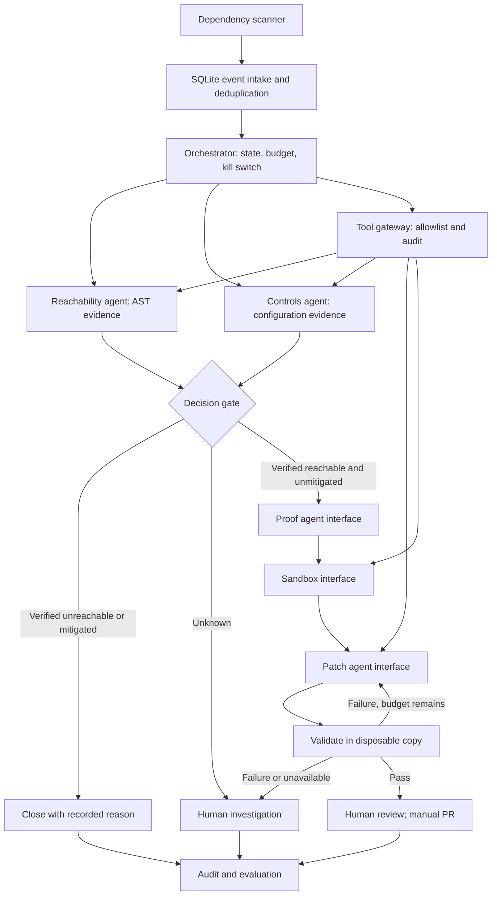

# Multi-agent vulnerability triage prototype




## Run

```bash
python3 -m vulnerability_triage --event vulnerability_triage/examples/event.json --project vulnerability_triage/examples/payment --audit-db triage_audit.sqlite
python3 -m vulnerability_triage.evaluate
python3 -m unittest discover -s vulnerability_triage/tests -v
```

The example produces `needs_review`: a call site is not proof of runtime reachability, and a WAF file is not proof of an effective deployed mitigation. The SQLite event store deduplicates identical event IDs and rejects conflicting reuse. Each run and gateway call is recorded with a trace ID. Inspect the `cases` and `audit` tables for the report and event history. A crash can leave an event `in_progress`; recovery and distributed event delivery are not implemented. The local audit database is not tamper-proof.

## Components and current boundaries

- `workflow.py`: intake, deduplication, orchestrator, decision gate, bounded attempts, kill switch, tool allowlist, trace and audit. Unknown findings go to a human; only explicit verified findings trigger closure or continuation.
- `harness.py`: simple Python AST call-site search, control-file evidence, a pinned-requirement diff generator and optional container runner. The built-in analysis cannot prove unreachable, reachable, mitigated or unmitigated status, so the default path does not automatically close or proceed to a patch.
- Proof and patch agents are injectable interfaces for future local-model integrations. The default workflow has no proof agent and never generates or runs a reproduction. The patch component supports one explicit dependency upgrade, not arbitrary code patches. The current retry path supports alternate agents only when they return the exact supported dependency diff.
- `evaluate.py` exercises four synthetic gate cases. Tests cover deduplication, unknown states, tool controls, container invocation and copy-based validation; they do not measure real-world false-positive rate, time to verified PR, or model quality.
- The result `human_review` is a local handoff, not a GitHub PR. There is no GitHub adapter, token, automatic merge, production access, model provider, broker, or external integrations. Human review and merge remain manual.

## Sandbox and security

The Docker runner is disabled without a locally pre-provisioned image pinned by SHA-256. It uses no network, a read-only root and project mount, dropped capabilities, non-root identity and resource limits. It runs argument lists without a shell. A container alone is not a secure isolation boundary for hostile code: use a disposable, independently isolated VM, no production credentials, and a trusted pre-sanitized source snapshot. Filename exclusions cannot guarantee a snapshot contains no secrets. The proof and patch interfaces are not configured by the CLI. An operator must verify any test, source snapshot, and image before enabling execution. No real sandbox run has been verified here.

The agent interfaces and verified-status gate are prototypes: do not connect a model that can self-assert `verified` without independent evidence validation and policy enforcement. Integrate signed scanner events, trusted vulnerability advisories, scoped GitHub credentials, a secure VM-backed sandbox, isolated dependency installation, reproducible full-suite tests, durable event handling, authorization, audit integrity and evaluation on labeled cases before operational use.
