# Fed-batch bioreactor: reinforcement learning and agentic supervision

A runnable, standard-library-only educational prototype. A tabular Q-learning controller chooses a daily feed rate over a 14-day simulated batch. An orchestrator runs a deterministic safety guardian, a statistical threshold monitor, a small local diagnostic knowledge base, and a structured batch reporter.

## Run

```bash
python3 -m bioreactor_rl --episodes 12000 --batches 50 --output batch_report.json
python3 -m bioreactor_rl --audit-log audit.jsonl
python3 -m unittest discover -s tests
```

The command trains with seed 42 and compares the learned policy with a constant 0.5-unit daily feed on the same 50 held-out seeds. It prints completion counts and mean final product **among completed batches** and writes an example full RL batch record. Paused batches are reported separately, since excluding them can bias yield comparisons. With the default seeds, this implementation produced fixed 5.366 and RL 5.788 mean simulated product, with 50/50 completed in both groups. This is a demonstration on one toy model, not evidence of real-world performance or statistical generalization.

## System design

```mermaid
flowchart TD
    subgraph training[Offline training]
        TS[Toy bioreactor simulator] -->|state and daily product reward| Q[Q-learning]
        Q -->|feed action| TS
        Q -->|learned Q-table| RL[RL feed policy]
    end

    subgraph batch[Supervised batch execution]
        SIM[Bioreactor simulator] -->|current state| ORCH[Orchestrator]
        ORCH -->|state| RL
        RL -->|proposed feed| ORCH
        ORCH -->|state| MON[Threshold monitor]
        MON -->|alerts| DIAG[Diagnostics: local knowledge mapping]
        DIAG -->|suggestions| ORCH
        ORCH -->|state and proposed feed| SAFE[Deterministic safety guardian]
        SAFE -->|allowed| SIM
        SAFE -->|blocked| PAUSE[Batch paused: awaiting human review]
        ORCH -->|observations, actions, decisions| REC[Batch record]
        SIM -->|resulting state| REC
        PAUSE --> REC
        REC --> REPORT[JSON reporter]
    end
```



Training runs separately from supervised batch execution and does not use the guardian. During execution, only an approved proposal advances the simulator; a blocked proposal ends the run in a paused state. Human approval and resumption are not implemented. The monitor, diagnostics, and reporter are deterministic placeholders for the proposed LLM-based agents; no LLM or RAG service is connected.

## Security and observability

The guardian rejects non-finite or invalid measurements and feed values, and the orchestrator rejects unknown modes. Optional `--audit-log` writes JSON Lines events for batch start, each safety decision, completed steps, and completion or pause. Events carry a unique batch trace ID, unique event ID, and UTC timestamp; the example report includes its trace ID. Logging errors stop execution. New audit files are created with owner-only permissions, and final-component symlinks are rejected where the operating system supports `O_NOFOLLOW`.

These are local prototype controls: trace IDs provide correlation, not distributed tracing or timing spans. The append-only interface is not tamper-proof storage, existing file permissions are not changed, and log rotation, retention, authentication, authorization, encryption, centralized collection, and concurrent-writer guarantees are not implemented. Protect output paths and existing files with operating-system permissions. Do not treat this as a validated production audit trail.

## Design

- **Simulator:** dimensionless glucose, cells, lactate, product, pH and oxygen evolve daily; temperature is fixed. Model equations and parameters are illustrative, not biologically calibrated. There is no volume, sensor delay, contamination, or process noise beyond initial glucose and oxygen noise.
- **RL:** discretized state and five feed actions; epsilon-greedy tabular Q-learning. Daily product increments provide reward shaping whose undiscounted sum equals final product. Training does not apply the deployment guardian, so the guardian can interrupt a learned policy.
- **Orchestrator:** proposes a feed, obtains monitoring and diagnostic observations, checks safety, and records each decision. A failed safety check pauses the batch with `awaiting_human_review`; there is no approval interface or resume capability yet.
- **Safety guardian:** deterministic, pre-action checks on current pH, oxygen, temperature, allowed feed, and a glucose guardrail. These illustrative limits do not guarantee future safety. It cannot be overridden by the other components.
- **Monitor and diagnostics:** deterministic alert thresholds and a local mapping of alerts to suggestions. These are placeholders for a small LLM and retrieval-augmented diagnostic service; no LLM or vector database is connected. Suggestions never control the reactor.
- **Reporter:** emits JSON with observations, proposals, decisions, alerts and resulting states; it does not generate LLM prose.

## Next steps

                                                                                                                                                                                                                                                                                                                                                                                                                                                                                                                                                                                                                                                                                                                                                                                                                                                                                                                                                                                                                                                                                                                                                                                                                                                                                                                                                                                                                                                                                                                                                                                                                                                                                                                                                                                                                                                                                                                                                                                                                                                                                                                                                                                                                                                                                                                                                                                                                                                                                                                                                                                                                                                                                                                                                                                                                                                                                                                                                                                                                                                                                                                                                                                                                                                                                                                                                                                                                                                                                                                                                                                                                                                                                                                                                                                                                                                                                                                                                                                                                                                                                                                                                                                                                                                                                                                                                                                                                                                                                                                                                                                                                                                                                                                                                                                                                                                                                                                                                                                                                                                                                                                                                                                                                                                                                                                                                                                                                                                                                                                                                                                                                                                                                                                                                                                                                                                                                                                                                                                                                                                                                                                                                                                                                                                                                                                                                                                                                                                                                                                                                                                                                                                                                                                                                                                                                                                                                                                                                                                                                                                                                                                                                                                                                                                                                                                                                                                                                                                                                                                Calibrate and validate a model against appropriate process data, model uncertainty and delayed observations, compare several baselines and random training seeds, report uncertainty and paused-batch outcomes, and evaluate safety under disturbances. Add authenticated human review and audit logging, then integrate LLMs behind explicit schemas with source citations and failure handling. Any physical deployment requires independent process validation and qualified controls; this prototype must not operate a real bioreactor.
